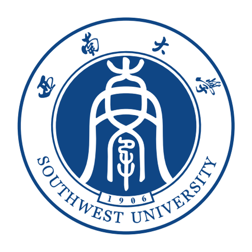
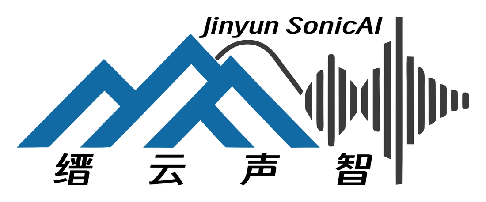

[**简体中文**](README.md) | [English](README.en.md)

# SoundSense Awakening · Music Ability Training and Assessment System

<p align="center">
  
  
  
</p>


An offline training tool for school music classrooms and basic musicianship courses. Students practise directly on a computer; the program listens to every strike through the microphone, judges whether the rhythm is accurate, and keeps practice data that can be compared and exported. Teachers can maintain a class roster, assign homework, review pass rates and generate pre/post progress reports. Everything runs on the local machine: no network, no account, no data upload.

License: MIT | Platform: Windows (the browser build is cross-platform) | Language: Simplified Chinese

## The problem it solves

Rhythm and theory training has long depended on the teacher listening to each student in turn. In a forty-minute lesson it is impossible to hear every student's rhythmic stability, and students practising at home get no objective feedback. Ordinary metronome apps only provide a reference pulse; they cannot tell a student whether the strike was early or late.

This project connects two things: browser audio input is compared with the beat grid in real time to produce millisecond-level deviation, accuracy and diagnostic advice; and every practice session is stored as local data that the pre/post report turns into a measurable progress figure, so teaching effect can be assessed with evidence.

## Features

| Module | Description |
| --- | --- |
| Rhythm levels | The microphone detects strike timing and marks each hit as on time, early or late, then reports accuracy, average deviation, a deviation chart, diagnostic advice and a weekly report; includes a 12-level progression, custom rhythm patterns and a configurable count-in |
| Theory exam items | Generates questions by exam type (note values and grouping, time signatures and meter, intervals, chords, key signatures and tonality, scales and modes, notation, musical terms) with the reasoning behind every answer and a retry-wrong-answers mode |
| Sight-reading | Imports MusicXML or MIDI scores, shows the staff and piano roll side by side, and judges pitch and timing note by note, in treble and bass clef |
| Chord practice | Four drills: inversion levels, 60-second speed run, chord playing and diatonic chord challenge |
| Ear-training tools | Pitch detection, key recognition by ear, chord note finder, metronome reference and a progression library |
| Theory handbook | Chinese articles on scales, chords, the circle of fifths, relative pitch and more |
| Class management | Builds a student roster and summarises practice count, average accuracy, score and best result for each student, with a class score sheet export |
| Homework | Assigns practice tasks with a pass mark; the program compares records automatically and decides whether each student passed, so no manual checking is needed |
| Pre/post report | Set a dividing date and the program produces pre-test, post-test, progress and conclusion tables for every module, printable or exportable |
| Data backup | One-click export of all data as JSON, with merge or overwrite import for moving between machines |

## Quick start

### Option 1: open directly (fastest)

Open `outputs/chordz-cn/home.html` in a browser. A recent Edge or Chrome is recommended.

The rhythm levels and pitch detection need microphone permission, and some browsers restrict recording when a page is opened through `file://`. The local service option below is therefore recommended.

### Option 2: local service (recommended)

The repository ships a zero-dependency static server and needs Node.js 18 or later:

```bash
node work/serve.js
```

Then open `http://127.0.0.1:8765/chordz-cn/home.html` in a browser.

### Option 3: desktop build

`work/legong-app` is an Electron wrapper that provides a standalone window without an address bar and native full screen:

```bash
cd work/legong-app
npm install
npm start
```

The Windows portable build can be produced with `electron-builder`; the output directory is excluded in `.gitignore` and is not distributed with the repository.

## Directory layout

```
README.md                 Project overview (Chinese)
README.en.md              Project overview (English)
LICENSE                   MIT license
THIRD_PARTY_NOTICES.md    Third-party sources and acknowledgements
CONTRIBUTING.md           Contribution guide
docs/                     User guide and software manual
tools/                    Pre-publication self-check script
outputs/chordz-cn/        Ready-to-run site (HTML/CSS/JS/icons)
work/                     Page sources, build scripts and check scripts
work/legong-app/          Electron wrapper sources
```

Every page of the site is a single HTML file with inline styles and logic, which makes classroom copying and projection simple. The page files under `work/` are the single source of truth; the build script turns them into the finished site.

## Technology

- Front end: plain HTML, CSS and JavaScript, no framework and no build dependency
- Audio: piano tones synthesised with the Web Audio API; the beat grid is driven by the high-resolution AudioContext clock
- Input: real-time microphone analysis (time-domain peak detection) and Web MIDI devices
- Scores: MusicXML / MIDI parsing, with the staff and piano roll drawn on Canvas
- Desktop wrapper: Electron
- Data: browser localStorage, all data stays on the local machine

## Implementation notes

**Rhythm judgement.** After playback starts, the theoretical time of every beat is recorded and each detected strike peak is converted into a relative deviation. A deviation within 70 ms counts as on time, 70 to 150 ms as off, and anything beyond that as early or late. The median offset of the session is used as a reference to cancel device and headphone latency. Scoring combines the deviation distribution, missed beats and extra strikes, and produces a final grade.

**Theory question generation.** Questions are computed from music-theory rules rather than drawn from a fixed bank: intervals are resolved from degree and semitone tables, chords are derived from root plus structure tones, key signatures, relative minors and parallel keys come from a key table, and pentatonic modes are produced by rotating a scale. Every question carries its reasoning, and a wrong answer is explained.

**Data and backup.** Practice records, level progress, the student roster and homework are written to localStorage under prefixed keys. The backup page exports everything as JSON and validates the file on import; a mismatched file never modifies existing data.

## Development and build

```bash
# Generate the finished site into outputs/chordz-cn
node work/build-cn.mjs

# Syntax-check the inline page scripts
node work/check-inline-js.mjs

# Sync to the Electron project
node work/sync-desktop.mjs

# Pre-publication self-check (personal material, secrets, local paths, oversized files)
node tools/preflight-check.mjs
```

## Privacy

The software does not connect to the network, does not create accounts and does not upload any data. Audio captured by the microphone is analysed in memory only; it is never recorded, stored or transmitted. Practice data stays in the local browser and can be exported or cleared by the user at any time.

## Known limitations

- Microphone judgement depends on device quality and ambient noise; in a noisy classroom, headphones or a MIDI digital piano are recommended.
- Score import for sight-reading supports MusicXML and MIDI; scanned images are not supported yet.
- Data lives in the local browser, so clearing browser data removes it. Export a backup regularly.
- The desktop build is only packaged and verified on Windows; other platforms must be built from source.

## Roadmap

- More textbook repertoire and sight-reading material
- Class-level teaching analysis reports
- A presentation mode for projection and peer assessment between students

## Contributing

Issues and pull requests are welcome; see [CONTRIBUTING.md](CONTRIBUTING.md) for details. Please run `node tools/preflight-check.mjs` before submitting.

## Copyright and authorship

© Music Acoustics Laboratory, Southwest University · Institute of Artistic Anthropology, Southwest University · Institute of Chinese Music and Mental Health, Southwest University

Author: Ma Ronghuan — 324737404+mading686-dotcom@users.noreply.github.com

Maintained by the 缙云声智 studio. Main site https://sfk8815-create.github.io | Mirror https://acouscope.vercel.app | GitHub https://github.com/sfk8815-create

## License and acknowledgements

This project is released under the MIT license, see [LICENSE](LICENSE).

It is derived from [Chordz](https://github.com/mymindwentblvnk/chordz) by Michael Eichenseer (MIT license). The structure, styling and parts of the interaction logic of the chord practice, progression library, pitch detection and theory handbook pages are based on that project; all interface text has been rewritten in Chinese and the features extended. The original copyright notice is preserved in full. Other third-party sources are listed in [THIRD_PARTY_NOTICES.md](THIRD_PARTY_NOTICES.md).
